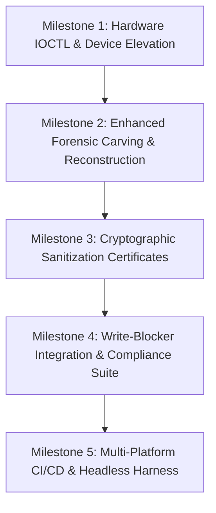

# LocardX

> **Enterprise Digital Forensics Workstation & Cryptographically Verified Data Sanitization Platform**  
> *Built with Rust, Tauri, React 18, and HeroUI.*

---

## 1. Executive Summary

**LocardX** is a high-assurance forensic recovery and data sanitization desktop workstation designed for digital investigators, incident response teams, and security administrators. Named after Edmond Locard’s exchange principle (*"every contact leaves a trace"*), LocardX addresses both critical sides of the storage media lifecycle:

1. **Forensic Recovery & Acquisition**: Bitstream raw image acquisition with on-the-fly SHA-256 verification, single-pass magic byte carving across damaged or unallocated storage, filesystem metadata traversal, and fragment reconstruction without contaminating evidence.
2. **Cryptographic Data Sanitization**: Permanent, irreversible media purge and surgical file destruction meeting **NIST SP 800-88 Rev. 1** and **DoD 5220.22-M** standards, backed by post-erasure verification sampling and tamper-evident SHA-256 hash-chained audit trails.

The application adheres to an **information-first, monochromatic enterprise desktop workstation design**, eliminating frivolous SaaS cards, gradients, and decorative colors in favor of dense, precise operational metadata.

---

## 2. Technology Stack & Workspace Architecture

### Core Tech Stack

| Layer | Technologies | Specifications |
| :--- | :--- | :--- |
| **Desktop Shell** | [Tauri](https://tauri.app/) | Secure IPC, zero-overhead Chromium WebView2 integration, native OS events |
| **Backend Core** | [Rust 2021](https://www.rust-lang.org/) | 14 focused workspace crates, memory safety, zero-cost abstractions |
| **Async & I/O** | [Tokio](https://tokio.rs/) | Non-blocking execution, multi-threaded worker pools, cooperative cancellation |
| **Persistence** | [SQLite](https://www.sqlite.org/) + `rusqlite` | Local database, WAL mode, transactional migrations |
| **Frontend UI** | [React 18.2](https://react.dev/), [TypeScript](https://www.typescriptlang.org/) | Strict types, modular component hierarchy, Vite bundler |
| **UI Components** | [HeroUI v2](https://heroui.com/) | Accessible, customizable enterprise UI component primitives |
| **Styling & Icons** | [Tailwind CSS v3.4](https://tailwindcss.com/), [Lucide](https://lucide.dev/) | Strict monochromatic workstation theme, unified icon set |
| **State Management**| [Zustand](https://github.com/pmndrs/zustand) | Decoupled client stores for cases, devices, recovery, sanitization, and app state |

---

### Workspace Crate Architecture

```text
locardX/
├── crates/
│   ├── acquisition/          # Bitstream DD disk imaging engine with streaming SHA-256 hashing
│   ├── audit/                # Tamper-evident SHA-256 hash-chained audit logging ledger
│   ├── auth/                 # Local closed-user provisioning, password hashing (Argon2), RBAC
│   ├── case-management/      # Case metadata, evidence registry, custody timeline, report aggregation
│   ├── common/               # Shared domain error models (LocardError), units, and DTOs
│   ├── database/             # SQLite connection pooling, schema migrations, transactional queries
│   ├── device-manager/       # OS physical drive enumeration, geometry detection, partition maps
│   ├── drive-eraser/         # Whole-disk sanitization, NIST 800-88 algorithms, DMA-aligned streaming
│   ├── file-eraser/          # Surgical file/folder destruction, CSPRNG overwriting, metadata wiping
│   ├── operation-manager/    # Unified task coordination, cancellation tokens, throttled progress
│   ├── recovery-engine/      # 256-way L1 dispatch carver, MFT traversal, fragmentation reassembly
│   ├── reporting/            # Evidentiary report compiler and certificate generation
│   ├── security/             # Cryptographic primitives, TOCTOU safety guards, system drive interlocks
│   └── verification/         # Post-erasure verification sampling, multi-pass hash check engines
├── src-tauri/                # Tauri commands, app state initialization, and IPC bridging
└── frontend/                 # React + HeroUI monochromatic workstation interface
```

---

## 3. Subagents Context & Engineering Guidelines

When multiple autonomous subagents or developers collaborate on LocardX, each agent must operate within strictly partitioned domain boundaries and adhere to invariant system laws.

### Subagent Roles & Domain Ownership

```text
┌─────────────────────────────────────────────────────────────────────────────────┐
│                           LOCARDX SUBAGENT MATRIX                               │
├───────────────────────────────┬─────────────────────────────────────────────────┤
│ Subagent Role                 │ Domain Ownership & Primary Crates               │
├───────────────────────────────┼─────────────────────────────────────────────────┤
│ 1. Storage & Sanitization     │ `drive-eraser`, `file-eraser`, `device-manager`,│
│    Engineer                   │ `verification`, `security`                      │
├───────────────────────────────┼─────────────────────────────────────────────────┤
│ 2. Forensics & Recovery       │ `recovery-engine`, `acquisition`, `reporting`,  │
│    Specialist                 │ `case-management`                               │
├───────────────────────────────┼─────────────────────────────────────────────────┤
│ 3. Core Platform & Security   │ `auth`, `audit`, `database`, `operation-manager`│
│    Architect                  │ `src-tauri` (IPC commands & capabilities)       │
├───────────────────────────────┼─────────────────────────────────────────────────┤
│ 4. Workstation UI/UX          │ `frontend/src/` (Components, Pages, Stores,     │
│    Architect                  │ Tailwind CSS, HeroUI provider)                  │
└───────────────────────────────┴─────────────────────────────────────────────────┘
```

### Invariant Rules for All Subagents

1. **Strict Monochromatic Color Discipline**:
   - Use only neutral shades (`#F8FAFC` to `#111827` in light mode; `#0B0F14` to `#E5E7EB` in dark mode).
   - Only **two** semantic colors are permitted: **RED** (Danger / Destructive Operations) and **AMBER** (Warnings / Operational Attention).
   - Never introduce module-specific colors (no blue forensics, no purple shredding, no green success badges).
2. **Zero-Card Information-First Layout**:
   - Content and whitespace define the visual hierarchy. Never wrap every component inside a HeroUI `<Card>`.
   - Use native tables, inline metric strips, and expandable data rows.
3. **Evidence Immutability Guarantee**:
   - Forensics and file carving routines must treat source media as **strictly read-only**. Never open an evidence image or source drive with write permissions.
4. **Safety Interlocks & TOCTOU Protection**:
   - Every destructive operation must perform live target re-probing immediately before executing write routines to prevent Time-of-Check to Time-of-Use (TOCTOU) drive swaps.
   - Operating system and boot drives are strictly protected and cannot be selected for whole-disk erasure.
5. **Zero Dependency Modification**:
   - Never add, remove, or modify package versions in `package.json` or `Cargo.toml`. Rely strictly on existing dependencies and native capabilities.

---

## 4. Current Implementation Status

### Completed & Production-Verified Modules

- [x] **Monochromatic Enterprise Workstation UI**: Complete rebuild of all views using HeroUI and custom workstation rails.
- [x] **Collapsible Case Navigation Rail**: Dual-mode collapsible "Investigations & Cases" browser with an ultra-slim 44px vertical rail and full-width workspace toggle.
- [x] **Clean Subtab Slider**: Overscroll-contained horizontal sliding subtab rail with zero visible scrollbar lines and auto-centering on active tab selection.
- [x] **Case Status Dropdown Workflow**: Replaced open horizontal button strips with an enterprise status dropdown selector (`Open`, `In Progress`, `Completed`, `Archived`).
- [x] **Single-Pass 256-Way Dispatch Detector**: L1-cache friendly array-indexed magic byte detection in `recovery-engine` avoiding multi-pass iterations.
- [x] **$O(\log N)$ Interval Carving Collision Check**: Replaced linear collision search with `BTreeMap<u64, u64>` interval checks and $O(1)$ filesystem offset set.
- [x] **Two-Stage Probing Engine**: 64 KiB structural header probe eliminating $O(C \times 32\text{ MiB})$ speculative heap allocations and disk I/O on false positives.
- [x] **Batched MFT Record Traversal**: 64 KiB contiguous block reads reducing NTFS MFT syscalls by **98.4%** (from 131,072 to 2,048).
- [x] **Database N+1 Query Elimination**: Single indexed SQLite query for job history returning $O(1)$ memory footprints.
- [x] **Frontend Table Virtualization & Pagination**: 50-item responsive pagination on recovery results with zero Virtual DOM freezing.
- [x] **Tamper-Evident SHA-256 Audit Chain**: Cryptographic linked-list audit logging with verification command.

---

## 5. Pending Work & Technical Gaps

Despite the strong architectural foundation, several capabilities remain to achieve full NIST SP 800-88 compliance and commercial forensic deployment:

1. **Hardware-Level IOCTL Commands**:
   - Direct ATA Secure Erase and NVMe Sanitize (`NVME_IOCTL_ADMIN_CMD`) command dispatch on physical Windows (`IOCTL_ATA_PASS_THROUGH`) and Linux (`/dev/nvmeXnY`). Currently, sanitization defaults to simulated or DMA block overwriting.
2. **Elevated Windows Privilege / UAC Escalation**:
   - Windows requires administrative elevation (`SE_MANAGE_VOLUME_NAME`, `GENERIC_WRITE` on `\\\\.\\PhysicalDriveX`) for direct unbuffered block writes. A dedicated privilege elevator or helper service is needed.
3. **Enhanced File Signature & Container Parsers**:
   - Advanced fragment reassembly for fragmented video containers (MP4 `moov`/`mdat` atom tree re-indexing).
   - Document relationship traversal for Microsoft Office OpenXML (DOCX, XLSX, PPTX) and PDF cross-reference stream reassembly.
4. **Cryptographic Certificate of Sanitization**:
   - Generation of digitally signed PDF and JSON Certificates of Destruction adhering to NIST SP 800-88 guidelines (recording drive serial, sanitization method, verification passes, and operator identity).
5. **Native Write-Blocker Detection**:
   - Automated detection of hardware write-blockers (Tableau, WiebeTech) and Windows software write-block registry flags (`StorageDevicePolicies\WriteProtect`).

---

## 6. Sequence of Implementation (Feature Roadmap)

To maintain stability and system integrity, future feature additions must follow this precise sequential plan:



### Milestone 1: Hardware IOCTL & Device Elevation
- **Goal**: Enable true physical drive raw sector manipulation and hardware command dispatch.
- **Tasks**:
  1. Implement Windows `IOCTL_STORAGE_MANAGE_DATA_SET_ATTRIBUTES` for trim/deallocate and `IOCTL_ATA_PASS_THROUGH` for ATA Secure Erase.
  2. Implement Linux `ioctl(fd, BLKDISCARD)` and `nvme_admin_cmd` for NVMe Block Erase / Crypto Erase.
  3. Implement privilege verification guards returning clear `PERMISSION_DENIED` errors when not executed as Administrator/root.
- **Verification**: Zero-write testing against virtual loopback devices and disposable USB media.

### Milestone 2: Enhanced Forensic Carving & Reconstruction
- **Goal**: Expand file signature coverage and fragmented file recovery.
- **Tasks**:
  1. Implement MP4 / MOV `moov` atom lookahead parsing for fragmented video streams.
  2. Implement ZIP / Office OpenXML central directory parser for compound documents.
  3. Add SQLite database page validator and B-tree leaf recovery.
  4. Implement entropy-based gap calculation for bifragment recovery.
- **Verification**: `cargo test -p locardx-recovery-engine` with test suite additions in `test-data/`.

### Milestone 3: Cryptographic Sanitization Certificates & PDF Generator
- **Goal**: Provide legally defensible proof of data sanitization.
- **Tasks**:
  1. Define the NIST SP 800-88 Rev. 1 Certificate Schema (Target Drive, Serial Number, Method, Verification Sampling, Hash, Operator, Timestamp).
  2. Implement report generation in both structured JSON and printable PDF format.
  3. Integrate local cryptographic key signing (Ed25519) of the generated certificate hash.
  4. Link certificate creation directly to the tamper-evident audit ledger.
- **Verification**: End-to-end report generation verified against `locardx-verification` test suite.

### Milestone 4: Write-Blocker Integration & Forensic Safety Suite
- **Goal**: Guarantee zero evidence contamination during live investigations.
- **Tasks**:
  1. Query Windows Registry for `StorageDevicePolicies\WriteProtect` status.
  2. Detect hardware write-blocker signatures in SCSI inquiry strings.
  3. Enforce read-only file handle flags (`FILE_SHARE_READ`, `OPEN_EXISTING`) across all physical device opening routines.
  4. Surface write-block status badges in the Device Explorer and Acquisition UI.
- **Verification**: Integration test confirming write operations fail-closed when write-block mode is active.

### Milestone 5: Headless Test Harness & Multi-Platform Packaging
- **Goal**: Automated verification and cross-platform distribution.
- **Tasks**:
  1. Build a headless verification runner capable of executing end-to-end acquisition, carving, and sanitization in GitHub Actions CI.
  2. Configure Windows MSI / NSIS installer bundling via Tauri.
  3. Configure Linux AppImage / Debian packaging.
- **Verification**: Automated clean CI runs on `develop` and `main` branches.

---

## 7. Development & Testing Commands

### Rust Backend
```bash
# Check compilation across all crates
cargo check --workspace

# Run complete workspace test suite
cargo test --workspace

# Run recovery engine tests
cargo test -p locardx-recovery-engine

# Code quality and formatting
cargo fmt --all -- --check
cargo clippy --workspace --all-targets -- -D warnings
```

### Frontend Workstation
```bash
cd frontend

# Verify TypeScript compilation and Vite production build
npm run build

# Run frontend tests (if configured)
npm run test

# Linting
npm run lint
```

### Launch Desktop Application
```bash
# Run from repository root (starts frontend and launches Tauri desktop window)
npm run tauri dev
```

---

## 8. Safety & Compliance Notice

> [!CAUTION]
> **LAB INTEGRITY WARNING**: LocardX interacts with low-level disk devices. During development and testing, **never** target personal drives, host operating system partitions, or unverified hardware. Always utilize loopback devices, synthetic sparse disk files, virtual machines, or verified disposable lab storage.

---

## 9. License

LocardX licensing is established in [LICENSE_SELECTION.md](LICENSE_SELECTION.md). All rights reserved under enterprise forensic and security standards.
